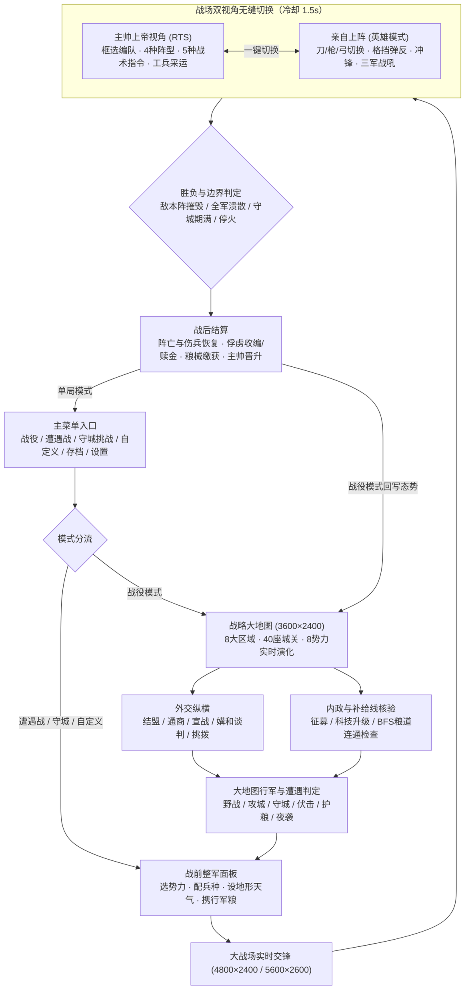

# 《火柴人冷兵器大战》（Stickman Cold Steel War）游戏总体设计文档（DESIGN.md）

- **目标平台**：华为鸿蒙 HarmonyOS NEXT（**华为鸿蒙平板 MatePad 大屏横屏优先**，兼顾 2in1 与手机，支持横竖屏切换、分屏与悬浮窗；纯单机离线运行，零联网依赖、零付费 SDK）
- **技术栈**：ArkTS + ArkUI + Canvas 2D 批量骨骼渲染，DevEco Studio 5.x，Stage 模型，API 12+
- **界面与资源准则**：完全依据本文档与 `entry/src/main/ets/config/` 静态单点真相源实现，不依赖任何外部作废参考图。
- **一句话核心体验**：玩家化身冷兵器时代的一军统帅，既能在 **4800×2400 宏大战场**上同时调度前锋、两翼与总预备队多军团排兵布阵、包抄合围、截断粮道，也能随时**一键提刀上阵**冲入敌阵挥砍挑骑、斩将夺旗；在 **8 大区域、40 座城关**构成的战略大地图上，与其余 **7 大特色势力**展开真实冷兵器战争与合纵连横博弈。

---

## 零、最高优先级铁律：真实冷兵器大战（拒绝静态 UI 摆拍）

战场与战役核心实现必须严格兑现以下**真实大战**硬指标，作为第 2 步战斗核心与第 3 步 Canvas 渲染的最高验收准绳：

1. **火柴人真刀真枪骨骼动作拼杀（绝非站桩棋子）**：
   - 每名火柴人士兵具备 **8 关节程序化骨骼状态机**（对应 `UnitActionState`）：持械呼吸戒备、行军奔跑摆臂、压低身姿冲锋撞阵、前摇蓄力、**刀盾挥砍 / 长枪突刺 / 巨斧劈砸**、挽弓抛射漫天箭雨、**举盾格挡火星迸溅**、受击后仰硬直与被战马撞飞抛物线、**阵亡倾倒遗骸留存**（环形上限 150 具尸体与折断旌旗烘托古战场惨烈感）、**士气崩溃丢盾抱头狂奔溃逃**。
2. **十二大冷兵器战术双向实装且真正决定胜负**：
   - **侧翼迂回、包抄背击、钳形夹击、铁桶合围、正面佯攻+侧翼偷袭、诈败诱敌、密林/反斜面伏击、奇袭断粮道、黑夜劫营夜袭、围点打援、高地压制、渡河半渡而击**——玩家与 AI 均可真实发动，且底层物理/伤害/士气引擎严格兑现侧背增伤与合围士气雪崩（详见 4.4 节数学模型）。
3. **多军团多战线同时交火（顾此失彼即败）**：
   - 单方最高编组 **6 大独立建制军团**（`1 中军前锋`、`2 左翼军团`、`3 右翼军团`、`4 总预备队`、`5 远程攻城群`、`6 辎重护粮队`），北翼山林、中路河谷、南翼草甸多条战线同步推进与拉锯，考验统帅全局分配兵力与预备队救火时机。
4. **主帅亲自上阵肉搏实感拉满**：
   - 玩家操控主帅冲入敌阵具备 `40ms` 重劈卡肉顿帧（Hit-Stop）、破阵微震屏、精准格挡弹反震退、长枪挑落骑兵、强弓点杀敌方军团旗手/敌帅等硬核操作反馈；主帅位置、血量、技能冷却与生死直接牵动全军士气涨落乃至瞬间崩盘。
5. **开战即大战验收基准**：进入战斗画面后，平板大视野内必须是**箭矢横飞、铁骑迂回、多条阵线犬牙交错推进与局部崩溃逃散的动态鲜活战场**。

---

## 一、核心玩法闭环与模式架构

游戏由**战略层（大地图战役与外交）**、**指挥层（RTS 实时战术调度）**与**动作层（主帅英雄亲自上阵）**三层体验无缝咬合：



### 六大可玩入口
1. **战役模式**：任选 8 大势力之一开局，其余 7 家由独立战略 AI 驱动（AI 之间同样会互相攻伐、结盟、背叛与媾和），直至统一全图核心王都或达成同盟霸权胜利。
2. **遭遇战**：快速单局标准会战，支持自选敌我势力、地图生态与人口规模，即开即打。
3. **守城挑战**：玩家据守雄关要塞，利用城墙、箭塔、拒马与有限粮草抵御多波次强敌围攻。
4. **自定义战场**：沙盒演武场，自由配置双方 16 种兵种编制、地形天气与初始粮草，验证阵型克制。
5. **本地存档**：基于 HarmonyOS 应用沙箱离线存储自动存档、手动多槽位存档及历史战役统计。
6. **游戏设置**：60/30 FPS 档位与远景 LOD 策略、左右手虚拟摇杆切换、音效与震动反馈开关。

---

## 二、三维资源、战场采集与后勤粮道设计

### 2.1 三种核心资源
| 资源类型 | 战场内获取方式 | 战役大地图获取方式 | 核心用途 | 耗尽后果 |
| :--- | :--- | :--- | :--- | :--- |
| **金币 (Gold)** | 辎重工兵开采野外金矿脉并运回大营；劫掠敌营 | 城池税赋、矿山产出、丝路通商协定、战争赔款 | 招募精锐兵种、研发科技、外交送礼/求和、商盟雇佣军 | 无法招募高阶兵种；沙漠商盟雇佣兵士气持续下滑 |
| **木材 (Wood)** | 辎重工兵砍伐林场运回 | 林场重镇产出、战后拆解缴获 | 制造弓弩、长枪、连弩车、投石车，修筑拒马/箭塔/云梯 | 无法补充远程器械与战场防御工事 |
| **粮草 (Grain)** | 战前自仓城携行 + 战场工兵抢收农庄/劫掠敌军粮车 | 丰穗仓城/绿洲农牧产出、附庸纳贡 | 招募士兵基础口粮、**全军每秒维持消耗**、大地图远征 | **触发【断粮】三级递进惩罚（掉移速、停体力、崩士气）** |

### 2.2 战场工兵与警钟机制（致敬并深化冷兵器前线后勤）
- 战场除双方本阵大营外，在中线侧翼分布有**野外金矿、林木区、农庄粮垛**。外派【辎重工兵】采集效率高于本阵自然产出，但暴露在敌方轻骑袭扰风险下。
- **本阵警钟（Garrison Bell）**：玩家遭遇敌骑偷家时可一键敲响大营警钟，附近工兵立即暂停采集退入大营围栏内，并通过营寨射击孔投掷石块/短弓协防，危机解除后再一键复工。

---

## 三、全兵种数值体系与克制数学模型（共 16 种：8 通用 + 8 专属）

### 3.1 核心伤害、破甲、盾防与冲锋公式
为保证数值透明可测、杜绝后期护甲免疫或刮痧，统一采用**双曲护甲减伤模型**：

1. **有效护甲**：
   $$A_{\text{eff}} = \max\bigl(0,\; A_{\text{target}} \times (1 - \text{Pen}_{\text{attacker}})\bigr)$$
2. **护甲减伤率**：
   $$\text{Mitigation}(A_{\text{eff}}) = \frac{A_{\text{eff}}}{A_{\text{eff}} + 50}$$
   > 物理含义：$A_{\text{eff}} = 50$ 时减伤 $50\%$（等效生命 $2\times$）；每增加 $50$ 点有效护甲线性增加 $100\%$ 基础等效生命，绝不会出现 $100\%$ 免伤死局。
3. **远程正面盾牌格挡**（仅当受击方正面朝向箭矢来袭夹角 $\le 60^\circ$ 时生效；侧射减半，背射为 $0$）：
   $$M_{\text{shield}} = 1 - \text{ShieldBlock}_{\text{target}}$$
4. **单次最终伤害**：
   $$\text{Damage} = \max\Bigl(2,\; \text{Atk} \times M_{\text{charge}} \times M_{\text{antiCav}} \times M_{\text{terrain}} \times M_{\text{morale}} \times M_{\text{shield}} \times \bigl(1 - \text{Mitigation}(A_{\text{eff}})\bigr)\Bigr)$$
   - **冲锋倍率 $M_{\text{charge}}$**：骑兵/突击兵连续直线加速满 $2.5\text{s}$（移速达到峰值 $85\%$ 以上）接敌首击触发 `chargeMultiplier`，随后进入 $8\text{s}$ 冲锋重整冷却。
   - **反骑倍率 $M_{\text{antiCav}}$ 与动能破甲**：长枪/戟兵处于**非溃逃、非奔跑冲锋**且正面迎向冲锋态骑兵时，触发 `antiCavalryMultiplier`（长枪兵高达 $3.2\times$），且借助敌马高速冲撞动能额外获得 **$+30\%$ 临时破甲率**（确保重装铁浮图正撞长枪方阵同样会遭受毁灭性穿刺），并强制清空骑兵冲锋动量！

### 3.2 八种全势力通用基础兵种数值表

| 兵种名称 | 定位 | HP | 攻击 | 破甲 | 护甲 | 盾远程减伤 | 射程 (盲区) | 攻速间隔 | 移速 | 冲锋 / 反骑 | 花费 (金/木/粮) | 训练 / 人口 / 秒耗粮 | 核心战术机制 |
| :--- | :--- | :---: | :---: | :---: | :---: | :---: | :---: | :---: | :---: | :---: | :---: | :---: | :--- |
| **辎重工兵** | 后勤辅兵 | 90 | 8 | 5% | 5 | 0% | 22 (0) | 1.40s | 68 | 1.0 / 1.0 | 35 / 10 / 15 | 5s / 1 / 0.05 | 采集金木粮、修筑拒马箭塔、抢修器械；鸣钟入营协防 |
| **刀盾步兵** | 抗线步兵 | 220 | 18 | 15% | 45 | **55%** | 26 (0) | 1.15s | 62 | 1.1 / 1.0 | 65 / 15 / 30 | 7s / 1 / 0.10 | 高盾防正面顶箭雨稳住战线；克弓手轻步，惧破甲巨斧 |
| **长枪方阵兵** | 反骑长柄 | 185 | 20 | 25% | 28 | 0% | **48** (0) | 1.25s | 58 | 1.0 / **3.2** | 55 / 30 / 30 | 7s / 1 / 0.10 | 双排叠刺，正面架枪迎骑享320%伤害+30%破甲并停马；怕箭雨 |
| **复合弓手** | 曲射远程 | 115 | 17 | 15% | 10 | 0% | **360** (45) | 1.50s | 66 | 1.0 / 1.0 | 60 / 35 / 25 | 8s / 1 / 0.09 | 抛射越过友军杀伤无盾目标，高地射程+20%；被骑兵秒切 |
| **游骑兵** | 机动轻骑 | 250 | 24 | 20% | 26 | 15% | 30 (0) | 1.10s | **118** | **2.1** / 1.0 | 125 / 20 / 65 | 11s / 2 / 0.22 | 580px大视野侦察开图，高速绕后切弓手器械粮车；忌撞枪阵 |
| **重型巨斧兵** | 破甲突击 | 205 | 34 | **65%** | 30 | 0% | 30 (0) | 1.55s | 57 | 1.35 / 1.15 | 95 / 25 / 40 | 9s / 1 / 0.14 | 无视 65% 护甲+半圆横扫溅射，专拆重甲刀盾与木城门 |
| **破甲连弩车** | 反甲器械 | 320 | 72 | **75%** | 22 | 0% | **540** (90) | 3.40s | 38 | 1.0 / 1.4 | 180 / 140 / 45 | 16s / 3 / 0.18 | 平射重型钢箭直线贯穿 3 人，专杀具装重骑与巨熊巨人 |
| **配重投石车** | 攻城重器 | 380 | 125 | 60% | 18 | 0% | **880** (220) | 6.20s | 28 | 1.0 / 1.0 | 240 / 210 / 60 | 20s / 4 / 0.24 | 超远面杀伤+对建筑 350% 伤害+砸崩密集阵士气；盲区大 |

### 3.3 八大势力专属王牌兵种数值表

| 专属兵种 | 所属势力 | HP | 攻击 | 破甲 | 护甲 | 盾防 | 射程 (盲区) | 攻速间隔 | 移速 | 冲锋 / 反骑 | 花费 (金/木/粮) | 训练 / 人口 / 秒耗粮 | 独有标志机制 |
| :--- | :--- | :---: | :---: | :---: | :---: | :---: | :---: | :---: | :---: | :---: | :---: | :---: | :--- |
| **炎龙神机重卫** | 炎龙帝国 | 335 | 32 | 45% | **62** | 40% | 38 (0) | 1.25s | 54 | 1.15 / **2.2** | 135 / 35 / 55 | 12s / 2 / 0.18 | 接敌前投掷震天火雷破阵并炸降敌军士气 -12，重甲反骑兼备 |
| **苍狼怯薛骑射** | 苍狼汗国 | 250 | 26 | 30% | 24 | 10% | **310** (0) | 1.30s | **124** | 1.65 / 1.0 | 145 / 45 / 65 | 12s / 2 / 0.20 | 支持“曼古歹”边退边射无盲区风筝重步，残局拔弯刀冲锋追斩 |
| **铁鹰重装神弩手** | 铁鹰王国 | 165 | 36 | **55%** | 32 | **60%** | **420** (50) | 2.35s | 56 | 1.0 / 1.1 | 110 / 55 / 35 | 10s / 1 / 0.12 | 钢弩高破甲直穿重甲；换弹期自动转身背大盾减免 60% 箭伤 |
| **黄金马穆鲁克** | 沙漠商盟 | 310 | 28 | 35% | 44 | 35% | 34 (0) | 1.15s | 104 | 1.85 / **1.9** | 175 / 20 / 60 | 11s / 2 / 0.19 | 披甲骆驼气味惊马光环：160px 内敌方战马移速与冲锋伤 -25% |
| **霜原巨熊破阵者** | 霜原熊族 | **620** | **66** | **70%** | 42 | 0% | 38 (0) | 1.75s | 60 | 1.50 / 1.40 | 185 / 45 / 95 | 14s / 3 / 0.30 | 1.35倍巨人身躯免疫普通击退，重锤扇形震飞前排，正面霸主 |
| **雾林影袭神射** | 雾林猎手 | 135 | 31 | 45% | 14 | 0% | **430** (30) | 1.55s | 78 | 1.0 / 1.0 | 115 / 50 / 35 | 10s / 1 / 0.11 | 密林/脱战潜行隐身，破隐首箭 180% 暴击并附带 3s 毒伤减速 |
| **玄甲具装铁浮图** | 玄甲重骑 | 420 | 38 | 45% | **68** | 45% | 36 (0) | 1.25s | 98 | **2.65** / 1.2 | 215 / 35 / 95 | 16s / 3 / 0.34 | 超高甲抗箭，冲锋可凿穿首层薄弱步兵直踏后排；惧拒马断粮 |
| **血月狂战祭团** | 血月祭司 | 160 | 26 | 40% | 4 | 0% | 28 (0) | **1.00s** | 78 | 1.45 / 1.0 | 85 / 15 / 45 | 8s / 1 / 0.12 | 战鼓锁士气 ≥50 不溃；损血加攻速且近战吸血，无甲极惧弓弩 |

### 3.4 兵种闭环克制关系
- **刀盾步兵** 顶盾克制 **复合弓手** -> **复合弓手** 齐射克制无盾 **长枪兵 / 巨斧兵 / 狂战士**
- **长枪方阵兵** 正面架枪克制 **游骑兵 / 具装重骑** -> **骑兵** 高速绕后克制 **弓弩手 / 投石车 / 工兵**
- **重型巨斧兵 / 巨熊破阵者** 高破甲横扫克制 **刀盾步兵 / 神机重卫** -> **连弩车 / 神弩手** 高破甲点杀克制 **巨人 / 具装重骑**
- **配重投石车** 砸崩密集 **方阵 / 城墙工事** -> **轻骑 / 影袭神射** 突入最小射程盲区摧毁 **投石车**

---

## 四、编队阵型、战术指令与士气系统

### 4.1 四种经典冷兵器编队阵型
| 阵型 | 几何排布 | 属性修正 | 适用兵种与场景 | 明显短板 |
| :--- | :--- | :--- | :--- | :--- |
| **方阵 (Phalanx)** | 密集矩形（深4~6排） | 护甲 +20%，抗骑兵冲锋击退 +50%，士气流失减缓 25% | 刀盾兵、长枪兵正面抗线 | 移速 -15%，极怕投石车面杀伤与火雷溅射 |
| **雁行阵 (Echelon)** | 宽幅双排弧线展开 | 远程有效齐射率 100%（无后排遮挡），受范围爆炸伤 -35% | 弓箭手、神弩手火力展开 | 阵线单薄，被骑兵锥形冲锋一戳即穿 |
| **锥形阵 (Wedge)** | 楔形三角箭头 | 移速 +8%，冲锋倍率额外 +25%，凿穿推挤力翻倍 | 游骑兵、铁浮图、巨斧突击 | 持续缠斗侧翼暴露，近战防御 -10% |
| **圆阵 (Circle)** | 环形外向防御阵 | **360° 消除侧翼/背击惩罚**，盾防与反骑全向生效 | 被四面包抄孤军待援、护卫投石车 | **无法移动**（或极慢蠕行），丧失主动进攻力 |

### 4.2 多军团建制与九种实时战术指令
玩家与 AI 均按 **【1 中军前锋】【2 左翼军团】【3 右翼军团】【4 总预备队】【5 远程攻城群】【6 辎重护粮队】** 多线建制独立下令（对应 `ArmyCorpsRole` 与 `TacticalOrder`）：
1. **稳步推进 (Advance)**：维持当前阵型间距匀速接敌，前排举盾/架枪，最稳健的正规战线压迫。
2. **原地坚守 (Hold Ground)**：死守高地/桥头/城门阵地，绝不被敌方诱饵勾引脱离掩护。
3. **全军冲锋 (All-Out Charge)**：激活冲锋动量高速扑杀撞阵，适合撕开动摇防线与追亡逐北。
4. **交替撤退 (Retreat)**：向本阵方向边退边格挡有序脱离接触，避免直接背身裸奔被屠杀。
5. **侧翼包抄 (Flank)**：寻路自动向目标编队左/右外侧偏移 $220\text{px}$ 大弧线迂回，绕过正面枪盾墙直插侧后。
6. **钳形合围 (Pincer Encircle)**：选定两翼军团对同一目标分左右双路同步包夹并封堵其后撤退路。
7. **诈败诱敌 (Feigned Retreat)**：接敌浅尝辄止后佯装快速后撤（保持阵型不掉士气），引诱贪功追击之敌踏入己方交叉火力袋或陷阱区后瞬间反身掩杀。
8. **潜伏设伏 (Ambush Hide)**：于密林、浓雾或山脊反斜面收旗静默潜伏，待敌军行军纵队经过或渡河至一半时暴起突袭。
9. **奇袭断粮 (Raid Supply)**：轻骑编队自动规避敌正面主力，专门寻路扑杀敌方野外采集工兵与随军粮车。

### 4.3 士气（Morale）状态机与迟滞防抖
每个作战军团独立维护士气值 $M \in [0, 100]$（基础值 $80$）：
- **高昂 ($85 \sim 100$)**：攻击 $+12\%$，移速 $+6\%$。触发源：主帅战吼、斩杀敌旗手/敌帅、击溃敌队、居高临下。
- **稳定 ($40 \sim 84$)**：标准战斗力（$100\%$）。
- **动摇 ($20 \sim 39$)**：攻击 $-20\%$，护甲有效率 $-15\%$，头顶闪烁黄旗告警。触发源：伤亡过半、侧背受袭、被巨石轰击、断粮饥饿。
- **溃逃 ($< 20$)**：部队脱离控制（丢盾抱头白旗狂奔）；**必须脱离接触且士气回升至 $\ge 32$（迟滞防抖环）**，或由主帅释放【三军战吼】才能重整归建！

### 4.4 八象限包抄、钳形夹击、铁桶合围与半渡而击数学模型
战斗核心每 $0.5\text{s}$ 对每个军团统计其周围 $160\text{px}$ 交战圈内敌军所处的 **8 个 $45^\circ$ 方位扇区**（对应 `EncirclementState`）：
- **侧翼打击（夹角 $60^\circ \sim 135^\circ$）**：受击伤害 **`+25%`**，单次士气打击 **$\times 1.5$**，正面盾牌格挡率减半。
- **背击突袭（夹角 $> 135^\circ$）**：受击伤害 **`+45%`**，单次士气打击 **$\times 2.0$**，**正面盾防与长枪架枪反骑完全失效（归零）**。
- **钳形夹击（Pincered）**：同时在 **$\ge 2$ 个互成钝角（方向夹角 $\ge 120^\circ$）的非正面扇区** 遭受不同敌军编队夹攻（如正面佯攻牵制 + 侧后骑兵突袭），阵型凝聚度瓦解（失去方阵护甲加成），且每秒额外流失士气 **`-2.2`**。
- **铁桶合围（Encircled）**：周围 **$\ge 5$ 个扇区（包围弧 $> 225^\circ$）** 存在敌军且退往本阵的逃生扇区被堵死，触发【四面楚歌】：除结【圆阵】苦撑可减半流失外，每秒士气雪崩流失 **`-4.8`** 且士气上限锁死 `45`，数秒内即全员恐慌溃散！
- **渡河半渡而击**：当敌方军团处于河流浅滩且**涉水人数占比介于 $30\% \sim 80\%$（水陆首尾脱节态）** 时遭袭，全军承受 **`+20%` 易伤与一次性 `-12` 士气震慑**。
- **大地图围点打援**：战役中围困敌城而不急于强攻时，可在通往该城的咽喉山林节点预设【打援伏兵】，截杀敌方驰援纵队（援军初始行军态无阵型加成且士气 `-10`），打援大捷后被围孤城守军士气直接锐减 `-25`。

---

## 五、亲自上阵：主帅英雄模式深度设计

玩家可随时点击右上角【亲自上阵 / 统帅全局】在 **RTS 上帝视角** 与 **主帅第三人称横版/斜俯视操控** 之间无缝切换（切换保护冷却 $1.5\text{s}$）。

### 5.1 左摇杆 + 右技能极简触控与三种武器实时切换
主帅基础生命值 $1100$，护甲 $55$，移速 $92\text{px/s}$，可在战斗中无损耗切换三把随身兵刃：
1. **统帅佩刀（刀盾态）**：攻速 $0.75\text{s}$，前方 $120^\circ$ 扇形挥砍（最多命中 3 名敌兵，单次 $48$ 伤害）；举盾主动格挡减免正面 $80\%$ 伤害，**起盾前 $0.25\text{s}$ 精准弹反窗口**可震退近身敌兵并使其眩晕 $1.5\text{s}$。
2. **破阵大枪（长兵态）**：攻速 $1.05\text{s}$，前方 $68\text{px}$ 直线穿透突刺（命中 2 人，单次 $62$ 伤害，$55\%$ 高破甲），对骑兵造成 $2.2\times$ 伤害并挑落轻骑。
3. **百石硬弓（狙击态）**：蓄力 $0.9\text{s}$ 射出重箭（射程 $460\text{px}$，满蓄力伤害 $95$ 且贯穿 2 人，适合狙杀敌军祭司/弩车手/敌帅）。
   > **防无脑风筝平衡限制**：主帅随身箭袋上限 **24 支**！射空后需靠近本阵大营/辎重车快速补满，或脱战状态下每 $2.5\text{s}$ 自动回收 1 支，彻底杜绝“玩家单骑无限箭风筝磨死三百敌军”的逃课漏洞。

### 5.2 主帅三大主动技能与前线拼杀实感设计
- **技能 1【破阵突击】（CD 10s）**：向前猛冲 $160\text{px}$，撞飞沿途敌方步兵（对巨人/铁浮图造成硬直并伴随镜头微震），若持长枪则伤害额外 $+40\%$。
- **技能 2【铁壁横戈】（CD 8s）**：持续 $2.0\text{s}$ 招架姿态，格挡反弹正面箭矢火星四溅，结束时旋身横扫周围 $55\text{px}$ 敌人。
- **技能 3【三军战吼】（CD 22s）**：以主帅为中心 $320\text{px}$ 内所有友军**立即恢复士气 $+18$（可直接唤醒溃逃部队重整反扑！）**、攻速与移速提升 $15\%$ 持续 $8\text{s}$；同时震慑 $180\text{px}$ 内敌军士气 $-10$。
- **动作打击感与斩将夺旗机制**：
  - 主帅挥刀重劈或长枪挑落骑兵命中时触发 **`40ms` 卡肉顿帧（Hit-Stop）+ 刀光残影 + 击退物理冲量**，绝无“空气挥剑飘浮感”。
  - **帅旗光环与斩旗夺帅**：主帅身处前线 $350\text{px}$ 内友军士气自然回升；每个敌方主力军团配有 1 名高辨识度**执旗官**，玩家操控主帅突入万军丛中砍倒敌执旗官可令该军团瞬间 `-15` 士气、阵型加成失效 $12\text{s}$；亲手阵斩敌军主帅更可触发全军士气沸腾 `+20` 与敌军全线雪崩 `-35`！

---

## 六、八大势力非对称设计详表（强强碰撞，绝无凑数弱势力）

| 势力名称 | 主色 / 旗帜 | 专属王牌兵种 | 核心强势法则 | 明确短板与反制突破口 | 专属科技三阶 | AI 战略与战术性格 |
| :--- | :--- | :--- | :--- | :--- | :--- | :--- |
| **1. 炎龙帝国** | 赤红 `#C62828`<br>赤底蟠龙金纹旗 | 炎龙神机重卫 | 步兵护甲+15%；攻城器械造价-20%、拆城伤害+25%；城防耐久+20% | 骑兵招募+15%；重装行军移速-5%，怕草原骑射拉扯断粮 | 《玄铁札甲》<br>《神机火雷》<br>《督战军法》 | **王道推进型**：重信守诺（信誉88），正面重步护双投石稳推，被夺核心城池死战不退 |
| **2. 苍狼汗国** | 苍青 `#0277BD`<br>苍青奔狼白纛旗 | 苍狼怯薛骑射 | 全骑兵移速+12%；远征补给惩罚-35%；劫掠农田粮车双倍获粮 | 禁造配重投石车（攻坚城吃力）；步兵抗线士气-5 | 《双马换乘》<br>《鸣镝齐射》<br>《草原劫掠》 | **游牧掠夺型**：战中分两翼绕后烧粮切弓手；大地图见弱即扑，给够岁币可速停火 |
| **3. 铁鹰王国** | 靛蓝 `#283593`<br>铁翼双头鹰旗 | 铁鹰重装神弩手 | 远程射程+12%；高地/城墙伤害+15%；修筑拒马箭塔速度+40% | 突击近战造价+10%；离开工事平推机动慢 | 《踏张钢弩》<br>《背盾轮射》<br>《棱堡工事》 | **稳健筑垒型**：必抢高地桥头立拒马护强弩，绝不轻易下山追诱饵；外交喜结防御同盟 |
| **4. 沙漠商盟** | 鎏金 `#F9A825`<br>鎏金天平弯月旗 | 黄金马穆鲁克 | 采金与通商收入+35%；耗纯金币**即时征召外邦雇佣军**；沙漠无惩罚 | 本土兵初始士气-6；若金币耗尽则雇佣军士气滑坡 | 《丝路商队》<br>《黄金契约》<br>《骆驼惊骑阵》 | **金元算计型**：广结商约攒巨富，遇强敌砸钱买和平或雇兵混编，无利不起早 |
| **5. 霜原熊族** | 冰蓝 `#29B6F6`<br>咆哮白熊图腾旗 | 霜原巨熊破阵者 | 全军生命+15%；雪原/暴雪免疫减速冻耗且近战伤+10% | 远程弓弩射程-10%；大胃王全军耗粮+15% | 《寒铁重斧》<br>《熊灵战意》<br>《雪原冬猎》 | **豪迈勇武型**：正面锥形阵硬凿中军斩首；外交敬重真正打赢他的强者，鄙视背盟小人 |
| **6. 雾林猎手** | 翡翠 `#2E7D32`<br>银叶鹿角旗 | 雾林影袭神射 | 密林移速反增+20%且透视林雾；可布设尖刺陷坑与绊马索 | 缺重甲抗线单位；无遮挡开阔平原正面对轰劣势 | 《见血封喉》<br>《诡道陷坑》<br>《迷雾潜行》 | **诡道伏击型**：领地意识极强，用小股散兵诈败诱敌入林中陷阱袋再三面毒箭围歼 |
| **7. 玄甲重骑** | 暗紫 `#7B1FA2`<br>玄铁狮鹫枪旗 | 玄甲具装铁浮图 | 骑兵护甲+25%、冲锋倍率+30%；击溃敌队重置50%冲锋CD并回士气 | 兵贵人少；泥泞浅滩与断粮时战马移速暴跌35% | 《人马具装》<br>《楔形连环马》<br>《铁蹄破阵》 | **傲慢铁血型**：专盯玩家阵线接合部或侧翼薄弱点，撕开缺口反复凿穿；极少屈服求和 |
| **8. 血月祭司** | 绯紫 `#AD1457`<br>血月骨鼓旗 | 血月狂战祭团 | 伤亡充能【血月狂热】全军加速免溃；夜战视野无损且攻击+15% | 主力无甲缺盾惧强弩火器攒射；正统诸侯初始关系-15 | 《血祭战鼓》<br>《永夜狂热》<br>《骸骨威慑》 | **狂热扩张型**：偏爱发动夜袭与波次狂战海冲垮敌军心理防线；常拉拢失意势力搅局 |

---

## 七、宏大战场（4800×2400+）与战略大地图（3600×2400，40节点）设计

### 7.1 单局大战场空间规划与动态视野迷雾（远超 4000×2000 硬性标准）
- **标准野战 / 遭遇战 / 护粮战尺寸**：`4800 × 2400 px`（火柴人身高约 `28px`，碰撞半径 `8px`，战场横向跨度相当于 **170 个士兵身位**，两军本阵大营相距 `3800px`）。
- **重型攻城战尺寸**：`5600 × 2600 px`（包含攻方营地、外围护城河吊桥、瓮城/双侧城门、可攀爬城墙段、城内街巷缓冲层与中心帅府）。
- **战场战争迷雾与侦察反伏击机制**：
  - 地形地貌与城防建筑全局可见，但**敌军动态兵力仅在友军视野半径内显形**（常规步兵视野 `420px`、游骑兵/哨骑视野 `580px`、登高望远 `+25%`、浓雾/黑夜 `-40%`）。
  - 敌军藏于密林且未开火时，非雾林势力必须抵近至 `140px` 内或派轻骑侦察方可识破，使南北走廊迂回包抄与丛林设伏具备真正的冷兵器情报博弈乐趣！
- **三路立体纵深布局**：
  - **北翼迂回走廊（Y: 150 ~ 680）**：山脊高地或密林暗道，分布野外林场/金矿，是轻骑绕后与伏击战高发带。
  - **中路主决战区（Y: 680 ~ 1720）**：开阔平原或中央河流浅滩/石桥，适合百人方阵正面对决与投石车对轰。
  - **南翼补给侧道（Y: 1720 ~ 2250）**：农庄粮垛与开阔草甸，适合包抄军团大回环切入敌方后排。

### 7.2 八种战场地形与五种天气昼夜影响矩阵

| 地形 / 环境 | 步兵移速 | 骑兵移速与冲锋 | 远程射程 / 命中 | 近战攻防修正 | 视野与耗粮特效 |
| :--- | :---: | :---: | :---: | :---: | :--- |
| **开阔平原** | 100% | 100%（完整冲锋） | 100% / 100% | 标准 100% | 视野标准，骑兵最佳驰骋地形 |
| **制高点/山坡** | 仰攻 -15% | 下坡冲锋伤 +15% | **射程 +20%** | 居高近战 +12% | 俯瞰视野 +25% |
| **河流浅滩** | -40% | **-45% 且禁冲锋** | 100% / 100% | **涉水护甲有效率 -15%** | 渡河半渡而击最佳歼灭点 |
| **桥梁/窄关** | 100% | 受限于桥宽易拥堵 | 100% / 100% | 窄口免除被包抄侧击 | 一队重装长枪即可封锁千军 |
| **迷雾密林** | -25%（雾林+20%） | **-35% 且禁冲锋** | 命中 -30%（树木遮挡） | 近战散斗阵型加成减半 | 林外无法看清林内伏兵（雾林透视） |
| **荒漠沙丘** | 重甲 -15% | -10%（商盟免疫） | 100% / 95% | 标准 100% | **耗粮速率 +30%**（商盟免疫） |
| **极寒雪原** | -15%（熊族免疫） | -15%（熊族免疫） | 100% / 95% | 熊族近战 +10% | **耗粮速率 +25%**（熊族免疫） |
| **城墙/工事掩体** | 需云梯/城门通行 | 骑兵不可登城墙 | **城头射程 +25%** | **掩体远程减伤 65%** | 投石车可轰塌城墙制造缺口 |
| **浓雾 / 黑夜** | 100% | 100% | 射程随视野受限 | 夜袭方首轮士气打击+15 | 视野缩减 40%~45%（血月夜战无损） |
| **暴雨 / 暴风雪** | -10% | **泥泞重骑移速 -30%** | 弓弦受潮射程 -20% | 火雷/火矢引燃效果减半 | 暴雪每秒额外耗粮并微降非耐寒军士气 |

### 7.3 战役战略大地图：8 大区域、40 座城关与 BFS 粮道模型
- **逻辑尺寸**：`3600 × 2400 px`，支持触屏双指缩放（`0.45x ~ 1.80x`）、拖拽漫游与右上角缩略小地图（含势力版图染色、交战双剑闪烁与当前视口框快速定位）。
- **八大板块与 40 节点均衡分布**（代码静态拓扑见 `entry/src/main/ets/config/CampaignMapConfig.ets`，**每大势力开局公平坐拥 5 座城关，全图共 40 节点、78 条对称双向道路连接**，各势力初始总经济严格配平在 `1415 ~ 1510` 区间，兼顾矿金/林木/粮仓资源禀赋差异）：
  1. **极北永冻霜原（霜原熊族，5节点）**：巨熊冰堡（王都）、冻湖祭坛、寒风隘口、雪松林寨、冰湾猎港
  2. **瀚海苍狼草原（苍狼汗国，5节点）**：金帐王庭（王都）、白狼山口、牧马滩、饮马河营、风蚀古堡
  3. **铁脊古战场高原（玄甲重骑，5节点）**：玄甲棱堡（王都）、望北烽燧、铁蹄平原城、裂谷重关、铸甲城
  4. **西境铁鹰山脉（铁鹰王国，5节点）**：鹰巢王城（王都）、断云天险、蓝河铁桥、石脊要塞、矿脉山城
  5. **中原赤炎平原（炎龙帝国，5节点）**：炎龙帝都（王都）、赤壁雄关、洛水渡口、铁炉堡、丰穗仓城
  6. **金沙绿洲走廊（沙漠商盟，5节点）**：黄金圣城（王都）、双月绿洲、红岩峡谷、商道驿垒、流沙古井
  7. **南疆迷雾幽林（雾林猎手，5节点）**：古树王庭（王都）、迷踪藤桥、翠影哨所、毒瘴谷口、灵木祭坛
  8. **幽暗血月盆地（血月祭司，5节点）**：血月神庙（王都）、骸骨关隘、暗河渡、赤雾寨、乱葬岗哨
- **补给线连通算法（BFS 最短合法跳数 $d$）**：
  每次行军或回合结算时，仅允许穿过**本方控制节点**或**正式军事同盟国节点**向本方任一 `isSupplyDepot = true` 的仓城/王都执行广度优先搜索（BFS）：
  - $d \le 2$：近境作战，补给效率 **100%**；
  - $d = 3$：长途远征，沿途民夫损耗使维持耗粮 **+25%**，开战初始携粮上限 **-15%**（苍狼汗国减免 35% 惩罚）；
  - $d \ge 4$：孤军悬远，维持耗粮 **+50%**，需尽快攻克敌方仓城转化为前线补给站或与邻国结盟借道；
  - $d = \infty$（归路节点全部被敌方或非同盟方占领阻断）：立即判定为**【粮道断绝 / 合围孤军】**！

---

## 八、外交系统：合纵连横、媾和估值与背盟铁律

### 8.1 双边关系值与全局外交信誉值
- **双边关系矩阵 $R_{i,j} \in [-100, +100]$**：受领土接壤摩擦（每回合 `-2`）、通商协定（每回合 `+2`）、共同抗敌（并肩作战一场 `+15`）、馈赠金粮（按金额折算，单回合递减防无限刷）、战争伤亡与背盟影响。
- **全局外交信誉 $C_i \in [0, 100]$**（初始 65~88 依势力而定）：衡量一国是否守约。严守停战期至自然届满每次 `+3`；撕毁盟约或停战期偷袭则信誉崩塌！

### 8.2 支持的外交行动
1. **正式宣战**：对无条约约束目标直接开战（无信誉损失，仅双边关系降至 `-80`）。
2. **停火媾和（可调筹码谈判）**：交战双方可调整 **赔款金币、每回合纳粮数、割让边境城池、停战回合数（5 / 8 / 12 回合）** 发起议和。
3. **互不侵犯条约**（需 $R \ge +15, C \ge 40$）：约定 8 回合互不攻伐，消除边境摩擦掉好感。
4. **丝路通商协定**（需 $R \ge +25$）：双方每回合额外获得贸易金币（沙漠商盟收益加成）。
5. **军事攻守同盟**（需 $R \ge +55, C \ge 50$）：共享战略视野、**开放粮道补给借道权**、一方被宣战可召唤盟友出兵夹击。
6. **朝贡附庸 / 挑拨离间**：残存 1 城的弱小势力可纳贡求存；玩家可耗费重金密使离间敌方两大强国同盟（关系 `-20`）。

### 8.3 媾和接受度量化公式（杜绝玄学随机数）
目标势力评估求和方案的净得分 $\text{AcceptScore}$：
$$\text{AcceptScore} = \underbrace{W_{\text{exhaust}}}_{\text{厌战度 (0\sim 45)}} - \underbrace{W_{\text{adv}}}_{\text{战场优势 (-40\sim +40)}} + \underbrace{V_{\text{offer}}}_{\text{筹码折算分}} + \underbrace{T_{\text{third}}}_{\text{第三方背后威胁 (0\sim 30)}} - \underbrace{P_{\text{cred}}}_{\text{低信誉怀疑折价}}$$
- 其中筹码折算 $V_{\text{offer}} = \frac{\text{金币}}{25} + \frac{\text{每回合纳粮} \times \text{回合}}{18} + \sum \text{割让城池价值}(25\sim 60)$；若求方占优索取割地赔款，则 $V_{\text{offer}}$ 为负值（需靠绝对战场优势 $W_{\text{adv}}$ 压服对方签城下之盟！）。
- **AI 反霸权制衡（防玩家滚雪球无聊平推）**：当任一势力（玩家或强盛 AI）占领城关超过全图 **35%（$\ge 13$ 座）** 时，触发【合纵警觉】，其余相邻非同盟势力之间自动获得 `+25` 共同威胁好感修正，促成反扩张联军，迫使玩家运用分化瓦解与远交近攻策略。

---

## 九、分层 AI 战术设计（拒绝无脑直线冲锋）

### 9.1 L1 战略大地图 AI（每回合独立演化）
7 个 AI 势力每回合按自身 `AiPersonality` 计算目标效用分（Utility Score）：
- **不围着玩家转**：苍狼会南下劫掠炎龙与玄甲，铁鹰会据险提防霜原与商盟，大地图每回合真实发生 AI 之间的攻城易手、停火割地与同盟重组。
- **两线作战规避**：除非是狂热的血月祭司团，常规 AI 在已与强敌交战时，若另一侧遭第三国压境，会主动向次要战线派使者割利求和，集中兵力打主战线。

### 9.2 L2 战场多军团战术指挥官 AI（每 0.5 秒更新态势黑板）
AI 绝不把所有士兵混成一团无脑直线冲锋，而是严格编组为 **中军前锋（40%）、左翼军团（18%）、右翼军团（18%）、总预备队（24%）** 多战线同步协同，动态执行七大高阶战术：
1. **正面佯攻 + 两翼钳形合围（Pinning & Pincer Encirclement）**：中军刀盾长枪方阵正面稳步压迫吸住玩家前锋，左右两翼骑兵/突击兵分别走南北走廊高速绕后，形成 $\ge 120^\circ$ 钳形夹击乃至五扇区铁桶合围，直接打崩玩家中军士气。
2. **渡口潜伏与半渡而击（Ford Interception）**：在含中央河流的战场上，AI 先按兵不动待玩家前锋涉水过半（水陆脱节态）时，令岸边潜伏弓弩齐射并派重步冲锋压岸，吃满 `+20%` 半渡易伤。
3. **高地刺猬防反（High-Ground Hedgehog）**：当 AI 处于守势或远程占优（如铁鹰王国）时，抢占最近高地或桥头进入【坚守】态，长枪护住两翼，投石车与强弩消耗；若玩家派单骑上前勾引，AI 仅用远程射击驱赶，**绝不全军无脑追出工事**。
4. **诈败诱敌伏击（Feigned Retreat & Forest Trap）**：雾林猎手与苍狼汗国 AI 以轻装前锋接战数秒后主动触发【诈败诱敌】后撤，若玩家贪功开启【全军冲锋】导致步弓脱节踏入密林陷阱区，AI 潜伏神射与两翼伏兵瞬间三面合围。
5. **断粮奇袭与总预备队决胜（Supply Raid & Reserve Commitment）**：AI 侦知玩家野外工兵无护卫时即分派游骑兵执行【奇袭断粮】焚毁粮车；同时扣留 24% 精锐总预备队，专门用于挽救己方濒溃侧翼或一锤定音凿穿玩家动摇缺口。
6. **反风筝与斩首围猎**：若玩家主帅孤身脱离友军阵线过远或血量低于 $45\%$，AI 会调集附近高破甲神弩与精锐骑兵实施合围斩首；若玩家主帅仅在阵前远射骚扰，则单派 1 支游骑驱离而非全军傻追。
7. **攻城与守城专项战术状态机（防无脑撞门送死）**：
   - **AI 攻城三段式**：① 炮火准备期——重步护住投石车/连弩车优先点拆城门两侧箭塔或轰塌薄弱城墙段；② 多点登城期——刀盾举盾顶箭雨掩护工兵架设左右两翼云梯牵制城头火力，巨斧兵集火劈砍正门；③ 破城突入期——城门或墙段告破后才投入具装重骑/巨熊总预备队冲入瓮城扩大战果。
   - **AI 守城三段式**：① 城头神弩/弓手高优先级集火推云梯工兵与无盾巨斧兵；② 城门耐久低于 30% 时自动调长枪与重步在门洞内结【圆阵/方阵】死堵缺口；③ 待攻方步兵全压城下导致后方空虚时，AI 从侧门派出 1 队游骑兵绕后奇袭烧毁攻方投石车。

### 9.3 L3 小队与单兵微操层
- **阵型弹簧槽位（Slot Spring Steering）**：每个士兵绑定所属分队的阵型局部坐标槽位，移动中兼顾维持队形与局部碰撞排斥。
- **兵种本能反应**：长枪兵检测到 $140\text{px}$ 内敌骑加速冲来时自动停步架枪；铁鹰神弩手进入换弹帧自动切换背盾朝向。

---

## 十、四大关键边界与极端异常闭环处理（重点打磨）

### 10.1 边界一：断粮（行军接敌节奏标定、大地图粮道被截 & 战场余粮耗尽）
- **开局携行粮草节奏标定（防未接敌先饿死）**：两军本阵相距 `3800px`，步兵对向行军接敌约需 `31s`；因此标准开局携行军粮设定为 **`1200`（`BATTLE_INIT_GRAIN = 1200`）**，足以支撑百人主力激战 `3.5 ~ 4.5 分钟`，既保证中前期正常排兵布阵，又使持久拉锯战中的野外农庄争夺与烧粮车战术成为胜负手！
- **大地图粮道截断**：第 1 回合消耗随军应急干粮（仅弹窗红色预警粮道被断，允许玩家立刻回师打通咽喉或向邻国借道）；若第 2 回合仍未接通补给线，进入【饥疲】：每回合非战斗逃亡减员 $8\%$、行军力 $-25\%$、进入战斗初始士气上限封顶 $65$。
- **战场内余粮归零**：绝不生硬直接判负，按三阶段递进：
  1. **余粮 $< 15\text{s}$ 预警**：顶部粮仓图标红闪+战鼓急促提示；
  2. **断粮 $0 \sim 30\text{s}$（饥饿期）**：停止自然回士气，全军士气每秒 `-0.8`，移速 `-12%`，骑兵冲锋冷却 `+50%`（玄甲重骑额外减速）；
  3. **断粮 $> 30\text{s}$（饥溃期）**：士气衰减加剧至每秒 `-1.8`，攻击力 `-25%`，沙漠商盟外籍雇佣兵若同时无金则直接退场，常规部队跌破 $20$ 士气成片溃散。
  - **翻盘出口**：玩家可派奇兵突袭焚掠敌方大营粮车当场夺取 **150 应急粮草**解除饥荒，或开启主帅【三军战吼】强锁士气发动斩首决死冲锋！

### 10.2 边界二：主帅阵亡（既鼓励提刀上阵，又保留擒贼擒王高风险）
采用**两段式“落马重伤 — 亲卫抢救 / 二次绝命”机制**：
1. **首次 HP 归零（落马重伤）**：
   - 全军瞬间遭受**【帅旗倾倒】士气暴击：全军当前士气立刻 `-35`，且士气上限临时锁死在 `65`**（前线本就动摇的部队会当场连锁溃逃！）；
   - 镜头自动平滑拉回 RTS 上帝视角（确保玩家仍能指挥残军自救），亲卫将重伤主帅护送回本阵大营医帐，经 $45\text{s}$ 包扎后以 **$35\%$ 残血 +【重创虚弱】（攻防移速 $-25\%$，失去免死保护）** 重新出战；
   - 若此时己方本阵大营已被攻破，或场上未溃逃兵力不足总编制 $10\%$ 且无后备军，则无法抢救，直接触发**【主帅殉国·全军溃败】**！
2. **二次 HP 归零（阵前战死）**：同一场战斗中挂着【重创虚弱】再次阵亡，不再有任何缓冲，全军士气瞬间清零，直接判定战败（战役模式下主帅由副将拼死抢回王都，挂 2 回合【重伤休养】全属性折损 Debuff）。
3. **对等规则**：敌方 AI 主帅同样在战场本阵或前线督战，玩家若亲手或集火击倒敌帅，敌军同样瞬间 `-35` 士气并陷入 $15\text{s}$ 指挥瘫痪（无法变阵与投入预备队）！

### 10.3 边界三：背盟（撕毁同盟或停战期偷袭）
当玩家（或机会主义 AI）对处于【军事同盟】【互不侵犯】或【停战协定期】未满的对象强行发起攻击时：
1. **二次确认强阻断弹窗**：清晰列出背盟后果，防止误触；
2. **信誉崩盘**：背盟方信誉值 $C$ 立即 **`-45`**，与受害国关系直接锁死 **`-100`** 并激活 **10 回合【血海世仇】**（期间受害国拒绝一切停火谈判！）；
3. **天下共愤**：全图其余所有存活势力对背盟方关系立即 **`-25`**；当 $C < 40$ 时，全图禁绝与其结盟，求和赔款要求溢价 **$+80\%$**；
4. **军心动摇**：背盟后连续 2 场战斗己方初始士气 **`-10`**（正统守序势力炎龙/铁鹰惩罚加倍至 `-16`，邪道血月祭司团减半至 `-5`）。
5. **双重同盟互攻豁免铁律（防被 AI 盟友拖下水强扣信誉）**：若玩家同时与 B、C 两国结有军事同盟，而 B 主动向 C 宣战，系统遵循**“防御同盟优先保护受侵略方”**原则——玩家选择协防被进攻方 C（或消耗外交行动居中调停促成 3 回合停火）**均不判定为对挑衅方 B 背盟，零信誉扣除**！

### 10.4 边界四：媾和失败与经济/攻城死锁防护
- **媾和三档结果闭环**：
  - $\text{AcceptScore} \ge 0$：**签约生效**，立即撤出交战领地并锁定停战期；
  - $-20 \le \text{AcceptScore} < 0$：**对方加价反制**，生成明确可负担的反报价单（若玩家金币不足则自动改索边境城池或分期纳粮，绝不生成负数或超出玩家资产上限的非法报价）；
  - $\text{AcceptScore} < -20$ 或处于世仇锁定期：**谈判破裂（斥退来使）**，本回合对该国锁定外交派使按钮（防无限穷举试探刷数值），双边关系 `-10`；若战前边缘讹诈破裂，对方当回合直接宣战压境；若战中屈辱求和被拒，敌军获下场战斗士气 `+8`。
- **零金币 + 零工兵经济死锁保底**：战场本阵大营自带每秒微量保底军饷（`+1.2 金/s, +0.5 木/s`），若己方工兵死绝且金币低于 35，大营每 $25\text{s}$ 自动免费征召 1 名应急民夫，确保永远不会卡死在“没钱造工兵、没工兵采钱”的死胡同。
- **攻城战器械全毁防卡死**：若攻方投石车全毁而城门未破，普通步兵可消耗少量木材在阵前临时扎制简易云梯登墙或用重斧/火把慢速劈烧城门（重斧对木质城门享额外破甲加成），绝不出现双方隔墙干瞪眼等超时的死局。

---

## 十一、HarmonyOS NEXT 项目架构、性能优化与可测试设计

### 11.1 Stage 模型分层目录规划（逻辑与 UI 严格解耦）
```text
entry/src/main/ets/
├── entryability/EntryAbility.ets             # 主 UIAbility（沉浸横屏初始化）
├── entrybackupability/EntryBackupAbility.ets # Stage 标准本地备份恢复扩展
├── common/GameConstants.ets                  # 全局尺寸、帧率、阈值常量
├── model/GameTypes.ets                       # 纯静态枚举与接口契约（零 UI 依赖）
├── config/                                   # 静态数值配置表（单点真相源）
│   ├── UnitConfig.ets                        # 16 种兵种完整数值表
│   ├── FactionConfig.ets                     # 8 大势力特性与科技表
│   └── CampaignMapConfig.ets                 # 40 节点大地图无向拓扑图
├── core/                                     # [第2阶段实现] 纯 ArkTS 游戏核心逻辑（无 ArkUI 依赖，可独立单测！）
│   ├── combat/                               # 空间网格寻敌、八象限合围、伤害破甲、阵型槽位、士气与英雄状态机
│   ├── ai/                                   # 多军团战场战术黑板 AI 与大地图效用决策 AI
│   ├── campaign/                             # 大地图回合推进、BFS 粮道计算、围点打援、断粮与俘虏结算
│   └── diplomacy/                            # 关系矩阵、信誉计算、媾和估值与背盟豁免判定
├── render/                                   # [第3阶段实现] 平板高分屏 Canvas 视口裁剪、火柴人骨骼合批渲染与 LOD
├── storage/                                  # [第3阶段实现] 离线沙箱存档持久化与战绩统计
└── pages/                                    # ArkUI Stage 路由页面层（平板响应式双栏薄视图层）
    ├── Index.ets                             # 主菜单（左模式列表 + 右势力详情双栏）
    ├── CampaignPage.ets                      # 战役大地图与右侧城防/外交谈判侧栏页
    ├── SetupPage.ets                         # 遭遇战 / 守城 / 自定义战前整军双栏页
    ├── BattlePage.ets                        # 4800×2400 大视野战场与右侧6军团指挥台页
    ├── BattleResultPage.ets                  # 战后军功伤亡结算页
    ├── SavePage.ets                          # 本地存档与战绩页
    └── SettingsPage.ets                      # 平板高刷、手写笔与摇杆设置页
```

### 11.2 平板高分屏同屏 300~600 火柴人 60FPS 性能优化铁律
1. **均匀空间哈希网格（Uniform Spatial Hash Grid）**：将 `4800×2400` 战场划分为 `120×120 px` 的 `40 × 20 = 800` 个网格桶，底层采用预分配定长 `Int32Array` 静态链表（`cellHead[800]` + `unitNext[600]`），每逻辑帧 $O(N)$ 重建，近战碰撞与弓手索敌仅扫描邻近格，把 $O(N^2)$ 的 $160,000$ 次距离平方计算压降至 $< 3,200$ 次，且完全消除数组动态扩容。
2. **零每帧对象分配（Zero Per-Frame GC）**：士兵实体池（600）、箭矢巨石池（400）、倒地遗骸环形池（150）、飘字粒子池（300）在战斗初始化时一次性预分配复用；帧循环内严禁 `new` 临时坐标对象、严禁高开销闭包 `.filter()/.map()`，杜绝 ArkTS GC 停顿掉帧。
3. **平板大视口裁剪（Viewport Culling）+ 多级 LOD**：针对华为 MatePad `2.5K~2.8K` 高分辨率宽阔视口，屏幕可视矩形外扩 `96px` 以外的士兵仅更新逻辑坐标，**100% 跳过骨骼角度解算与 Canvas 绘制调用**；当玩家双指捏合拉远全局鸟瞰（缩放 $< 0.60\times$）同屏容纳三四百名士兵时，自动切入远景精简 LOD（保留头、躯干、主兵刃挥动与军团阵旗，省略次级肘膝细节）。
4. **Canvas 同色路径合批渲染（Path Batching）**：严禁每个火柴人单独调一次 `ctx.stroke()`！渲染器按势力主色与武器材质分组：先 `ctx.beginPath()` 一次性写入同势力屏幕内全部百余名士兵的躯干四肢线段，最后仅调用 **1 次 `ctx.stroke()`**，将每帧数千次 Canvas JNI 绘制调用压缩至 **25 次以内**。
5. **逻辑与 UI 状态隔离**：Canvas 帧动画由内部高精度计时循环直驱画布重绘，ArkUI `@State` 顶部资源/粮草/士气数字仅以 **4Hz（每 250ms）** 节流同步，防止每秒 60 次触发全组件树脏检查。

### 11.3 独立单元测试方案（Hypium + 纯函数无 UI 验证）
所有位于 `ets/config/` 与后续 `ets/core/` 的模块均**不依赖任何 `@kit.ArkUI` 组件上下文**，可在 `entry/src/ohosTest/ets/test/` 中通过 `@ohos/hypium` 直接断言：
- **第 1 步已落地测试**（见 `Ability.test.ets`）：断言战场尺寸 $\ge 4000\times 2000$、战役区域数 $= 8$ 且节点数 $= 40$、平板触控最小热区 $\ge 48\text{vp}$、8 大势力各公平拥有 5 座初始城关且王都为补给仓城、16 兵种正定性与百人军团开局粮草耐力 $\ge 100\text{s}$、大地图 40 节点无向图对称且 BFS 单连通无孤岛。
- **第 2 阶段核心单测清单**：
  1. 护甲双曲减伤、重型巨斧破甲与长枪架枪 `+30%` 动能破甲精确伤害断言；
  2. 八象限包抄背击、钳形夹击（`-2.2/s` 士气）、五扇区铁桶合围（`-4.8/s` 士气雪崩）与半渡而击断言；
  3. 士气跌破 $20$ 溃逃及迟滞回升至 $32$ 恢复控制防抖测试；
  4. 主帅首次落马（全军士气 `-35`、上限锁 `65`）与二次阵亡判负边界测试；
  5. BFS 补给线连通跳数与围城断粮状态判定测试；
  6. 外交背盟惩罚、双重同盟防御优先豁免铁律与媾和评分三档分支测试。

---

## 十二、鸿蒙平板版（MatePad）专项适配、大屏交互与多窗防崩设计

本项目以 **华为鸿蒙平板（MatePad 11.5" / 12.2" / 13.2" 等大屏设备）横屏模式** 为首要目标形态设计，绝非手机竖屏小界面简单拉伸放大：

### 12.1 Stage 系统配置与分屏/悬浮窗/旋转防崩机制
- **设备类型与多窗声明（`entry/src/main/module.json5`）**：
  - `"deviceTypes": ["tablet", "2in1", "phone"]`（平板置首）；
  - `"supportWindowMode": ["fullscreen", "split", "floating"]`（完整支持全屏、平板分屏与悬浮窗）；
  - `"orientation": "auto_rotation"` 搭配 `"preferMultiWindowOrientation": "landscape_auto"`（以大屏横屏为主，支持用户翻转平板或切入竖屏/分屏）。
- **动态窗口尺寸监听（`EntryAbility.ets`）**：
  - 通过 `mainWindow.on('windowSizeChange')` 实时向 `AppStorage` 同步 `winWidthPx`、`winHeightPx` 与 `isWideScreen`（宽高比 $\ge 1.05$ 为横屏双栏宽幅态，进入窄分屏或竖屏时自动平滑切换为上下弹性分栏 `FlexDirection.Column`），并在 `onWindowStageDestroy` 安全解绑监听；全屏系统栏隐藏调用均包裹异步 `.catch` 容错，确保切入悬浮窗/分屏时绝不报错崩溃、绝无内容裁切或变形。

### 12.2 四大核心界面平板大屏左右分栏规范（告别手机单列堆叠）
| 核心界面 | 平板横屏左侧主区（Master） | 平板横屏右侧详情/操控区（Detail） | 大屏视野优势 |
| :--- | :--- | :--- | :--- |
| **1. 主菜单 (`Index`)** | `36%` 宽：游戏铭牌 + 6 大模式宽幅入口卡片 | `64%` 宽：8 大势力双列国旗纹章矩阵 + 底部非对称强弱项详情横幅 | 一屏尽览全部模式与八国特色，零滚动局促感 |
| **2. 战役大地图 (`CampaignPage`)** | `65%~70%` 宽：可缩放漫游大地图视口，一次看清多个战略板块、山川河道与粮道连线 + 右上小地图 | `30%~35%` 宽：常驻城池驻防/产粮详情卡 + **外交面板抽屉** | 边看全图多线战局与盟友态势，边在右侧直接微调筹码谈判 |
| **3. 战场指挥/上阵 (`BattlePage`)** | `70%~74%` 宽：超宽幅 `4800×2400` 战场主视口（同时纵览前锋接触线与南北两翼迂回走廊） | `26%~30%` 宽：1~6 号军团实时血量/士气/受围告警列表 + 阵型与 9 大战术指令盘 | 右手点选军团与战术不遮挡中央交战画面；切英雄模式自动浮现左右大尺寸摇杆与刀枪弓轮盘 |
| **4. 外交与战前整军 (`SetupPage`)** | `60%~62%` 宽：8 国关系矩阵热力图 / 16 兵种招募大卡片网格 | `38%~40%` 宽：使者议和条件滑块（金币/割城/停战期） / 兵种克制详评与军团编制槽 | 信息密度充沛、字体清晰（正文 `14~16fp`，标题 `18~28fp`），杜绝弹窗套弹窗 |

### 12.3 平板手指大热区与 M-Pencil 手写笔专属交互
1. **平板大尺寸触控热区**：所有可点击按钮、军团卡片与外交滑块最小触控高度统一 **$\ge 48\text{vp}$（主操作按钮 `54vp`）**，手指拾取编队容差半径放大至 `44px`，杜绝误触相邻编队。
2. **多指手势漫游**：战役大地图与实时战场均支持**双指捏合无级缩放（`PinchGesture`，战场 `0.45x ~ 1.65x`、大地图 `0.45x ~ 1.80x`）**与双指/单指空白处平滑拖拽视口（`PanGesture`）。
3. **华为 M-Pencil 手写笔战术画线**：识别 `SourceTool.Pen` 笔尖输入（精准拾取容差 `24px`），支持玩家用笔尖点选某军团后直接在战场上**手绘一条迂回曲线直指敌军侧后翼**，系统自动将该笔迹采样转化为军团的【侧翼包抄 / 钳形合围】路径航点，还原冷兵器统帅在沙盘上执笔划箭头的真实临场爽感！
